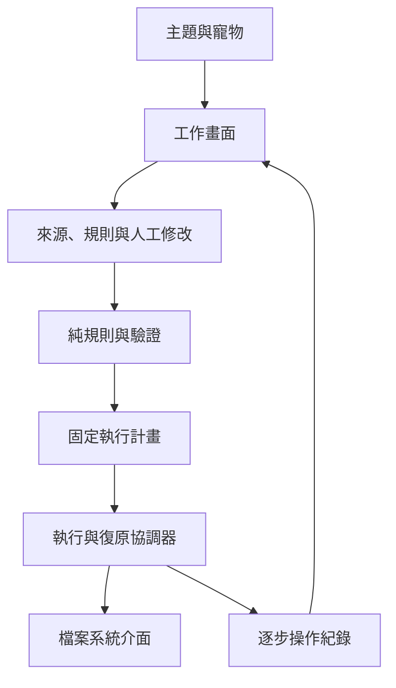

# Batch File Renamer：專案 Review 與後續實作規劃

版本：V1.0.0　｜　審查日期：2026-10-18　｜　文件狀態：規劃稿，尚未實作

專案：https://github.com/yoyoCadence/Batch-file-renamer

固定審查基準：`main`，commit `2be62ed4a8bb36f923da7742f935a5b881399604`。

## 1. 結論與使用方式

專案已具備實用的產品雛形：本機處理、先預覽再執行、規則組合、四語系、CSV、排除列、執行紀錄、復原，以及可選擇的主題與寵物。純規則邏輯已與 UI 分離，沒有必要為了改善品質而先換框架或加入後端。

目前最需要改善的是「畫面承諾與實際檔案操作的一致性」。本次在原始函式與模擬檔案系統中，重現了復原覆寫既有檔案、CSV 顯示與實際複製來源／目的地不一致、磁碟檢查失敗仍放行、排除狀態因篩選而失效等問題。這些問題應早於新視覺效果與功能擴充處理。

建議路線：**補上安全回歸測試 → 修復執行／復原 → 穩定預覽狀態與規則結果 → 改善主要工作畫面及無障礙 → 優化 PWA 與效能 → 擴充功能**。

本文件可直接交給後續 agent，包含發現、證據、重現情境、架構方向、任務依賴與驗收條件。本文中的「建議」「應」「驗收」都是未來工作，不能當成已完成的功能。

本次沒有修改產品原始碼、既有測試、tasks.md、版本、部署或 GitHub PR；僅讀取專案、安裝既有測試依賴、執行檢查、建立獨立審查探針與本文件。實作仍須等待使用者後續指示。

## 2. 審查範圍與證據界線

### 2.1 已檢視範圍

| 區域 | 已檢視內容 | 判讀重點 |
|---|---|---|
| 核心應用 | `pwa/assets/app.js`，約 2,717 行 | 狀態、事件、預覽、執行、復原、CSV、檔案權限、寵物 |
| 規則引擎 | `pwa/assets/rules.js`，約 826 行 | 轉換、檔名驗證、衝突、CSV、復原計畫 |
| 設定與文字 | `pwa/assets/settings.js`，約 2,421 行 | 儲存、正規化、四語系、模板／主題／寵物註冊 |
| UI | `pwa/index.html`、`pwa/assets/style.css` | 資訊架構、表單、表格、樣式、動畫、響應式與無障礙 |
| PWA | manifest、`pwa/service-worker.js` | 快取、更新、離線與資料保留 |
| 測試／交付 | Node 測試、Playwright specs／fixtures／fake-fs、package、Pages workflow | 真正覆蓋範圍與測試盲區 |
| 文件／歷史 | AGENTS、README、CHANGELOG、tasks、refactor-plan、legacy-audit | 產品承諾、已知限制、接手規則 |
| Legacy | PowerShell、啟動器、README | 原始功能與檔案操作語意；未在 Windows 執行 |
| 實際 UI | 已部署 GitHub Pages，桌面 1348 × 936 | 空白／新增規則、設定、深色主題、英文、啟用寵物 |

Repository 約 116 個追蹤檔案；圖片與精靈素材以資源結構、大小、使用方式及實際畫面抽樣檢查，未逐一做美術品質評分。未將每一個翻譯句子視為已完成語言校對。

### 2.2 證據分類

- **R：可重現的程式行為。** 將基準版本的原始函式放入 Node VM，使用模擬檔案系統與 UI stub；或直接呼叫純函式。不是完整瀏覽器 E2E，也不是 Windows 真實磁碟驗證。
- **U：實際瀏覽器 UI 觀察。** 在部署站操作與讀取 DOM／計算樣式；不能據此推論所有瀏覽器或視窗尺寸都正常。
- **S：靜態程式風險。** 有明確程式路徑，但本次尚未執行完整重現。
- **D：設計／產品決策。** 現行行為可確認，但是否修改涉及明確產品語意。

後文的 R 不代表資料損害曾發生在使用者電腦；所有覆寫情境都使用測試資料與模擬檔案系統。

### 2.3 實際測試結果

| 檢查 | 結果 | 限制 |
|---|---|---|
| `npm ci --ignore-scripts` | 完成 | 安裝既有依賴，未變更 lockfile |
| `npm test` | **36 / 36 通過**，0 失敗，約 206 ms | Node runner 報告的測試數；不是 36 種完整使用流程，也不是程式覆蓋率 |
| `npm run test:e2e` | **62 個測試均在 Chromium 啟動階段失敗** | 缺少 Chromium headless shell；不是 62 個產品 bug，也不能報為通過 |
| Playwright 官方 Chromium 安裝 | 嘗試完整包與 only-shell，未成功 | 下載內容不完整／ZIP 結尾錯誤；因此無法完成本機 E2E |
| 獨立原始碼探針 | 20 個情境執行完成，無 harness error | 包含 bug、已知限制與語意問題；不能一概稱為「20 個重大 bug」 |
| 部署站 UI | 可開啟、加入規則、切換語言／主題、操作設定及寵物 | 未對真實使用者檔案執行改名／複製／復原；未做手機實機測試 |
| GitHub Actions | 同一 SHA 的 run `31318494389` 成功 | workflow 只執行 Node 測試並部署，不能替代 E2E |

環境：Node `24.19.0`、npm `11.9.0`、Playwright `1.61.1`。部署站畫面與所查版本結構一致，但未逐一比對其所有資源位元組，故原始碼重現證據與線上 UI 觀察分開記錄。

## 3. 現有架構評估

### 3.1 值得保留的設計

1. 靜態 PWA、無後端、檔案在本機處理，符合使用情境，也降低維運成本。
2. `rules.js` 以純函式處理多數轉換，方便直接測試、之後移往 Worker。
3. 預覽、驗證、只執行 OK 列的流程方向正確。
4. 已有資料夾權限與檔案拖放／選檔的能力區別，不應在改版時消失。
5. 已有規則啟用／排序、預設集、CSV、scope、搜尋、排除、紀錄與復原，不需要把這些重新包裝成「待新增功能」。
6. 既有四語系與主題註冊可延續；寵物目前預設關閉，是合理的低干擾起點。

### 3.2 結構性問題

| 問題 | 造成的影響 | 建議 |
|---|---|---|
| `app.js` 同時管理執行、DOM、儲存、預覽與約數百行寵物邏輯 | 檔案安全修改容易影響 UI；測試需擷取函式 | 依責任小步抽出模組，不一次重寫 |
| 顯示路徑文字與真實 directory handle 分離，但驗證仍依顯示文字 | 看起來不同的目的地實際寫進同一資料夾 | 真實 binding 是操作依據；顯示字串只負責呈現 |
| 規則結果、人工修改、磁碟狀態共用可覆寫的 rows | 重建預覽遺失修改；檢查結果過期 | 分離來源、規則輸出、人工 override、驗證、執行狀態 |
| `status` 用英文文字與 `Error:` 前綴兼任資料模型 | Done 誤算警告、錯誤與驗證互相黏住 | 使用代碼與結構化 detail，翻譯放在顯示層 |
| 執行過程讀取 mutable 全域 state | 操作中切換模板／目的地可能影響剩餘列 | 先產生不可變 ExecutionPlan，再交 executor |
| 單一 `lastBatch` 且只有完全成功 rename 才入帳 | 部分成功沒有恢復依據，復原失敗也丟失紀錄 | 每列逐階段 journal；復原與一般執行共用安全原則 |
| 設定、資源註冊與四語系集中於大檔案 | 維護成本高、寵物文案漏接 i18n | 儲存介面與 catalogs 分離，分批移動 |
| 測試偏向純函式／文字 wiring | 有綠燈但仍可能覆寫檔案 | 增加帶錯誤注入的 executor integration 與真瀏覽器流程 |

### 3.3 建議的漸進式責任邊界

保留原生 ESM。以下是責任名稱，實作時可依既有目錄命名，不要求一次建立全部檔案。

| 模組 | 責任 | 禁止耦合 |
|---|---|---|
| `domain/rules` | 正規化規則、名稱轉換、逐步 trace、時間／序號輸入 | 不讀 DOM、localStorage 或磁碟 |
| `domain/validation` | 檔名、衝突群組、有效操作集合、結構化狀態 | 不以翻譯後文字當狀態 |
| `state/preview` | stable ID、override、排除、選取、revision | 不直接寫檔 |
| `filesystem/adapter` | handle binding、權限、查詢、讀寫、錯誤分類 | 不依顯示路徑猜位置 |
| `execution/planner` | immutable plan、來源／目標身份、執行前置條件 | 不在執行中讀 UI |
| `execution/runner` | 單一執行鎖、逐列步驟、進度、暫停／取消邊界 | 不把未知結果當成功 |
| `execution/journal` | 每步紀錄、部分成功、復原與恢復資訊 | 不刪除尚未解決的紀錄 |
| `io/csv`、`storage` | schema、匯入綁定資料、版本遷移、安全讀寫 | CSV 文字不授予檔案權限 |
| `ui/*`、`appearance/*` | rendering、操作事件、設定、主題、寵物 | 寵物不能改變核心操作狀態 |



## 4. 問題清單與修正規格

優先級：**P0**＝已重現的覆寫／實際操作與確認內容不符，先阻止危險路徑；**P1**＝主要流程正確性或恢復能力；**P2**＝可用性、效能、無障礙與維護；**P3**＝加值功能。此分級是本專案排程用途，不是 CVSS 安全評級。

### F01／P0：復原會覆寫新出現的原檔名；失敗後失去重試資訊

- 證據：R，B01、B02；`app.js` 的 `undoLastBatch()`，約 L1296–1325。
- 重現：先記錄 `a.txt → za.txt` 成功；外部程式又建立 `a.txt`，內容為 `NEW_EXTERNAL`；按復原。
- 實際：直接寫入 `a.txt`，其內容變成原本 `za.txt` 的內容，接著刪除 `za.txt`。若復原失敗，仍無條件清空 `lastBatch`。
- 預期：原檔名已被占用時停止該列；不能覆寫外部檔案。復原來源若被外部修改，也應標示衝突，不擅自處理。
- 修正：復原前驗證來源身份／內容與目的地；逐列記錄成功／失敗／衝突；只將完成列標為已復原，保留 unresolved 操作；提供可匯出的恢復報告。
- 驗收：外部 `a.txt` 的位元組完全不變；missing source、permission denied、write/close/delete failure 都保留可追查紀錄；第二次操作只處理未解決列。

### F02／P0：CSV 與可編輯資料夾標籤不代表真正執行位置

- 證據：R，B06、B20；`app.js` 的 `applyFolderLabel()`、`importCsv()`、`executeCopyRow()`，`rules.js` 的 `validateRows()`、`parsePreviewCsv()`。
- 重現一：目前模板內容 `CURRENT_TEMPLATE`、輸出 handle 是資料夾 S；匯入 Copy 列，宣稱來源 `Other/other.txt`、目標 `OtherFolder/out.txt`。
- 實際：複製的是目前模板，實際位置是 `S/out.txt`；執行紀錄卻將 CSV 的來源／目的地記為 Done。
- 重現二：兩列 `TargetName=same.txt`，顯示資料夾分別 LabelA、LabelB。驗證將它們視為不同目標，但 executor 都寫入 S/same.txt，兩列均報 Done。
- 修正：第一階段只支援單一真實 Copy 輸出資料夾。目標欄顯示實際已綁定目錄；未綁定 CSV 列必須 blocked。CSV 不同來源不得默默套用目前模板。建立明確匯入綁定步驟：確認來源模板、輸出目錄、操作類型與欄位對應；不匹配就拒絕執行。
- 衝突 key 必須來自真實目錄身份與目標名稱，不能是 display path。兩個 handle 是否同目錄須經 adapter 解析／`isSameEntry` 類能力判斷，不能只比較 `.name`。
- 驗收：不同標籤指向同一實體目錄時能擋重名；紀錄與實際來源內容、位置一致；未完成綁定不能執行。B20 的變動模板內容只用來顯示第二次寫入覆蓋第一次，正常模板不一定改變，但重複寫入與假成功仍成立。

### F03／P0：磁碟檢查錯誤被當成不存在，且檢查與寫入之間可發生覆寫

- 證據：R，B07、B08；`revalidateWithFilesystem()` 約 L1133–1153、`executeRows()` 約 L1235、`writeFileToDirectory()`。
- 重現一：查詢目標時拋 `NotAllowedError`。catch 設 `targetExists=false`，列變成 OK。
- 重現二：執行前檢查時不存在目標，確認對話框期間出現同名檔案；後續 `create:true`／`createWritable()` 寫入該檔案。
- 修正：只有明確 `NotFoundError` 才代表不存在；拒絕、I/O 失敗、無法確認應為 blocked／unknown。固定執行計畫後，每列寫入前再次驗證必要前置條件；任何身份或內容變動都中止該列並記錄。
- **技術界線：重新檢查不能消除所有競爭條件。** 不可把「多查一次」宣稱為原子 no-overwrite。要調查目標瀏覽器在使用者選取目錄上的可用 API 與原子性；不能假定支援 native move、exclusive create 或 OS rename。
- 驗收：錯誤查詢永遠不導致 OK；插入外部檔案的測試不覆寫；文件明確描述剩餘競爭限制。若平台無法滿足嚴格 no-clobber，應限制／阻擋相關自動路徑，或另提原生工具選項，不能掩蓋限制。

### F04／P1：改名是複製後刪除，部分成功沒有足夠紀錄

- 證據：R，B09；S：`executeRows()`、`executeRenameRow()`、`state.lastBatch`。
- 重現：目標寫入／close 成功，來源 removeEntry 失敗。
- 實際：來源與目標都保留，結果只寫 Error，且此列沒有進入復原紀錄。這次重現是重複檔與恢復資訊不足，**沒有證明來源遺失**。
- 其他靜態風險：沒有單一執行鎖；多次點擊或執行中改模板／輸出可啟動重疊流程。成功後 source references／預覽與磁碟狀態也需一致更新，不能讓下一輪繼續操作舊檔名。
- 修正：建立 `validating → ready → executing → completed/partial/failed/cancelled` 批次生命週期；每列記錄讀取、建立、寫入、close、驗證、來源刪除等階段。執行中凍結影響該批次的輸入。
- 取消只在安全步驟邊界停止後續列；不能把正在 close 的寫入假裝已撤銷。cleanup 只處理能確認由本次建立且未被外部改動的檔案。
- 驗收：逐階段注入失敗仍有真實狀態與恢復指引；雙擊只產生一個 batch；修改 UI 不改變既有 plan；執行及復原後重新對應來源，畫面不保留錯誤 Done 狀態。

### F05／P1：排除列會因 scope 改變而重新變成可執行

- 證據：R，B03、B04；`rules.js` 約 L595–610 的 ID 建立；`validateForApp()`、`applyExecutionLimits()`。
- 重現：來源 a.txt、b.txt，排除 b；scope 改成只包含 b。
- 實際：ID 從 `rename-source:b.txt-1` 變為 `rename-source:b.txt-0`，原排除集合對不到，列回到 OK。
- 另一問題：同目標兩列，第一列排除後第二列仍是 Duplicate target，因 duplicate 計算早於排除。
- 修正：來源載入時建立 stable sourceId；不要把目前排序／篩選 index 放進身份。排除資訊獨立於顯示。重複目標驗證只看真正要執行的集合；所有碰撞列要能看見同一衝突群組，避免「第一列自動勝出」造成誤解。
- 驗收：scope、排序、搜尋、重新預覽、語言切換均不讓排除失效；排除一列可解開其他列碰撞；複製列 ID 也需綁定批次／模板語境，避免把舊 copy-0 的選取套到新模板。

### F06／P1：重新檢查會丟掉人工修改；磁碟衝突旗標可能過期

- 證據：R，B05、B15；`previewRules()` L1109 起、`updateRow()` L1997 起。
- 重現：規則產生 x_a.txt，人工改成 MANUAL.txt，按「重新檢查（含磁碟）」。
- 實際：先重建規則列，再檢查磁碟，人工值回到 x_a.txt。此按鈕的說明是重新檢查，因此不同於歷史上已知的「修改規則會重算」限制。
- 另：目標原本衝突，改成空閒名稱後仍可能保留 `targetExists=true`；按重新檢查又會失去人工名稱。
- 修正：分開 `generatePreview` 與 `revalidateCurrentRows`；override 以 stable ID 保存。人工改名使對應磁碟檢查結果失效，顯示待檢查，而非沿用舊結果。規則變動保留 override 並標註；需提供明確「重設人工修改」操作。
- 驗收：手改、快速修正、CSV 值都不被單純檢查抹掉；磁碟結果只適用於該 row revision；晚回來的非同步結果不能覆蓋新名稱。

### F07／P1：隱藏表單值仍影響新規則

- 證據：R，B18；`readRuleForm()`、`buildPreviewRows()` 的 usesList 判斷。
- 重現：在段落規則選 List，之後切換到前綴／後綴；新增規則仍帶著 `valueMode:'List'`，即使該欄已隱藏。
- 實際：前綴操作因清單行數不符被阻擋。
- 修正：各 rule type 定義可用欄位，normalize 時丟棄／忽略無關欄位；usesList 只由真正消費清單的規則決定。
- 驗收：切換所有 rule type 組合；隱藏欄位不改變行為；舊 preset／session 經正規化仍能載入。

### F08／P1：規則卡逐步預覽與完整規則引擎結果不同

- 證據：R，B19；`ruleChainPreviews()` 與 `applyRulesToName()`。
- 重現：a.txt 先改副檔名為 tar.gz，再取代檔名主體中的 tar 為 zip。
- 實際：完整引擎得到 a.tar.gz；卡片逐條重新拆副檔名，得到 a.zip.gz。
- 修正：單一 engine 回傳每一步 trace，主預覽、卡片、範例共用同一計算，不在 UI 重做演算法。明確定義多重副檔名是整段 extension 還是只取最後一段。
- 驗收：所有規則排列的 trace 最終值等於完整結果；包含 extension→replace、cleanup→case、dotfile、無副檔名與日期 token。

### F09／P1：保留名稱快速修正無法處理多重副檔名

- 證據：R，B11；`rules.js` 的 `escapeReservedName()` 約 L207。
- 重現：`CON.tar.gz` → `CON.tar_.gz`。
- 實際：仍被引擎判為 Reserved name。
- 修正：修正真正造成保留名稱的第一個名稱部分，再完整驗證；若不能安全修復，提供人工處理而非顯示成功。
- 驗收：CON、CON.txt、CON.tar.gz、大小寫變體、其他裝置保留名；輸出不得仍觸發同一問題，也不能產生新碰撞。

### F10／P1–P2：PWA 快取與更新生命週期不夠安全

- 證據：R，B16；`service-worker.js` 約 L79–90。activate 刪除所有名稱不是當前 cache 的快取，會刪掉同 origin 其他應用的 CacheStorage；探針已重現刪掉 unrelated-pwa-v1。
- 修正：cache key 加入本應用與 scope 的 namespace；只清自己的舊版本。GitHub Pages 不同專案路徑仍可能共用 origin，不能只依 SW scope 假定隔離。
- S：`app.js` 的 `controllerchange` 直接 reload；第一次 claim 或更新可能清空記憶體中的來源／人工修改。現有 E2E 特意 block SW，因此沒有覆蓋此行為。
- 修正：區分首次控制與更新；有 unsaved preview 或 executing／undoing 時不得自動 reload。提供更新提示與安全套用時機；定義多分頁策略。可持久化草稿，但權限需重驗。
- 資源：`pwa/` 約 10,678,638 bytes，背景約 8.6 MiB、寵物約 1.5 MiB；目前 app shell 預快取包含大量可選資源。這是檔案大小統計，不是實測網路傳輸量或載入耗時。
- 優化：必要 shell 與選用外觀資源分開，按需快取；保留已選主題離線可用，資源載入失敗有基本樣式 fallback。cache 版本由 manifest／內容版本產生，降低手動忘記 bump 的機率。
- 驗收：其他 app cache 不變；首次安裝、更新、離線、舊頁面配新 SW、多分頁、執行中更新均有獨立瀏覽器測試。

### F11／P2：完成狀態被當成需處理；設定寫入失敗未妥善降級

- 證據：R，B14：兩列 Done，摘要回傳 ok=0、blocked=2、error=0；`summarizeRows()` 約 L2511。
- 修正：分離 ready、blocked、excluded、done、failed、partial；計數與篩選使用同一狀態分類器，完成後顯示實際結果。
- 證據：R，B12：`saveSettings()` 約 L2385，storage.setItem 失敗向外拋；與已有較安全處理的其他儲存路徑不一致。
- 修正：集中 storage adapter。失敗時設定仍可於本次會話套用，清楚提示未儲存；不要因持久化失敗讓 UI 操作中斷。存取 localStorage 本身可能失敗的路徑亦需納入測試（此點為 S）。
- 驗收：QuotaExceededError、SecurityError、無效 JSON、舊 schema；正常／失敗計數加總一致，狀態篩選與摘要一致。

### F12／P2：Regex 可能長時間阻塞主執行緒

- 證據：R，B17；`applyRulesToName()` 直接同步執行使用者 regex。
- 探針：25 字元輸入與 `(a+)+$`，單次約 170 ms。此數字只是本次 Node 環境樣本，不能當手機基準或推估所有 regex。
- 修正：先定義 rule count、input length、copy count、padding 等合理上限；較大批次與 regex 計算放 Worker，設計整體 deadline、可終止 worker 與進度。不用單純 try/catch 處理長時間計算，因為它不能中斷 regex。
- 驗收：惡意／病態 regex 不凍結 UI；終止後保留輸入、可繼續操作；一般合法 regex 語意不改變。大批次 DOM 更新應節流，不每一列都重繪全表。

### F13／D、P2：只變更大小寫目前無法執行

- 證據：R，B10；`normalizePathKey()`／`validateRows()` 會將來源與目的地轉為小寫比較，abc.txt → ABC.txt 是 No change。
- 歷史 tasks 已將其記為現行限制，不能當作本次才引入的 regression。
- 建議：UI 先明確說明限制。若要支援，需在 Windows 真實目錄驗證安全中介名稱／平台 rename 能力、衝突與復原，不能單純移除 lowercase 檢查。
- 驗收：大小寫敏感／不敏感的檔案系統分開；失敗不覆寫或遺失來源；一般 No change 仍正確。

### F14／D、P2：非 regex 取代仍會解讀 `$&` 等 replacement token

- 證據：R，B13；abc.txt 查找 b、替換 `$&`、useRegex=false，結果仍是 abc.txt。
- 這是 JavaScript replacement 語意；「非 regex」是否也代表 replacement literal，現有產品文字不夠明確，因此不能直接斷言為無條件 bug。
- 建議預設：一般取代視替換值為字面文字；regex 模式才開放 `$1`／`$&` 並給範例。若保留現行行為，必須明示。
- 驗收：`$&`、`$$`、`$1`、空值、反斜線、Unicode、所有／單次取代有規格與測試。

### F15／P1–P2：CSV 匯入流程與輸出格式需要明確契約

- S：Rename 匯入列沒有 sourceRef；目前不能直接執行，重新選來源又可能重建 rows。使用者缺乏「把 CSV 計畫綁回真實檔案」流程。
- 修正：版本化 schema、必填欄／Action 白名單、列級錯誤、名稱與路徑一致性、重複列檢查；CSV 不可信，Status 不能授權執行。檔案綁定後重新驗證，不相信匯入的 OK。
- 來源只允許選定目錄內明確匹配的檔案；模糊名稱、同名不同目錄、缺檔、多餘檔、不同模板都要顯示。
- 輸出需區分可回匯的原始資料與方便試算表閱讀的版本。以 `= + - @` 開頭的名稱可能被試算表解讀為公式；此為格式風險，未在 Excel 實測。不可為了防公式而默默改真正檔名或破壞 round-trip。
- 驗收：逗號、雙引號、換行、BOM、中文、emoji、空欄、不完整引號、未知 Action、大檔案、formula-leading 值；四語系介面使用同一穩定 schema。

## 5. UI、視覺與互動改善方案

### 5.1 實際觀察與設計判斷

部署站桌面檢視下，流程說明、來源與規則設定占用首屏主要空間，預覽區約在 y=809 才開始。來源面板與較高的規則面板並排，造成來源區下方大面積留白。預覽工具列同時呈現許多相近權重按鈕，對第一次使用者不容易辨認下一步。

這不是需要增加更多裝飾的問題，而是要讓「改了哪些檔案、有哪些風險、下一步能做什麼」更容易看到。保留現有主題、背景與角色辨識度，把預覽與錯誤處理提升為主要視覺焦點。

### 5.2 桌面工作區

建議於 ≥1200 px 使用左側約 300–340 px 設定欄、右側主要預覽區；這是待驗證的設計起點，不是已測得最佳尺寸。

| 區域 | 建議內容 | 行為 |
|---|---|---|
| 精簡頁首 | 名稱、目前模式、瀏覽器能力、設定 | 完整教學收合，首次使用才展開 |
| 左側「來源」 | 實際資料夾、檔數、scope、載入能力 | 清楚區別可執行與僅預覽；長路徑可展開 |
| 左側「規則」 | 已建立規則清單、添加／編輯、預設集 | 編輯器按需求展開；每條卡片顯示 before/after |
| 主要預覽 | 原檔名、目標名、差異、狀態、選取／排除 | sticky 表頭；錯誤可定位；名稱編輯不用切頁 |
| 批次操作列 | 搜尋、狀態篩選、選取操作 | 匯入／匯出／重設等次要動作收進選單 |
| 底部摘要 | 可執行、衝突、排除、完成數；主按鈕 | 顯示執行將影響幾個檔案，sticky 不遮內容 |

主動作依狀態變化：載入來源 → 建立規則 → 處理衝突 → 執行 N 列 → 檢視結果／復原。不要同時讓多個不同階段的動作看起來都一樣重要。

目前「選取列」是批次編輯用途，「執行 OK 列」則可能包含未選取列。應在摘要與確認畫面明示，避免使用者以為只會處理勾選的項目。若新增「只執行選取」，必須是獨立清楚的動作。

### 5.3 預覽表格與錯誤處理

- 預設以原檔名 → 目標檔名為中心，highlight 變更片段；顏色搭配文字／圖示，不只靠紅綠。
- 目標資料夾與名稱綁定真實執行計畫；禁止自由輸入路徑文字卻假裝可改實體位置。
- 狀態點選後顯示「原因、影響、可採取動作」；例如同名衝突可定位衝突列、改名、排除或產生 suffix，但不自動覆寫。
- 人工修改加上標記與單列還原；規則變更後保留修改並呈現來源，而非偷偷覆蓋。
- 依狀態篩選後保留原始列號／來源身份；「scope 改變運算集合」與「搜尋只是隱藏列」要不同文案。
- 檔案大小、長路徑等非必要欄位可選；大量資料才引入虛擬表格，並保留鍵盤／讀屏操作。

### 5.4 視覺規格與主題

採語意 tokens：surface、surface-raised、text、text-muted、border、accent、on-accent、success、warning、danger、focus。每套主題需提供可讀的前景／背景組合，不能只換 accent 顏色。

實際測量到一組主要按鈕為白字、背景 `rgb(94,169,158)`、字級 16 px，對比約 **2.75:1**。依 WCAG 一般文字 4.5:1 的基準，這個組合需要調整。這不是全部主題的完整無障礙稽核。

建議保留兩種密度：舒適與緊湊。表單與表格可先以 14–16 px 文字、可辨識行高、至少約 40–44 px 主要點擊區域設計；不使用過小次要文字呈現風險。最終以實際裝置、200% 縮放及 WCAG 目標驗收。

背景降低存在感，主要工作面使用足夠不透明度；避免多層 blur／陰影／高亮同時競爭。深色模式單獨檢查 muted text、input、disabled、hover、focus、status 色，不把亮色主題反轉即視為完成。

### 5.5 動畫與寵物

保留為可選個人化；預設關閉狀態不必改動。提供「工作專注」選項，減少背景與動態，保留使用者原本主題偏好。

目前實際開啟寵物後，角色／對話可能覆蓋規則區的控制項；E2E fixture 也明文記載寵物會攔截點擊。英文 UI 中仍出現中文對話，某角色 aria-label 顯示 `pet.portal-file-mender` 原始 key。

改善規格：

1. 為角色設定不覆蓋表格、輸入框、主要按鈕、dialog 的安全區；使用者編輯或執行時停止穿越。
2. 裝飾層不攔截點擊；拖曳互動使用明確角色範圍或專用控制，不以全畫面透明層接事件。
3. 支援 `prefers-reduced-motion` 與手動停止；關閉／背景分頁時停止 rAF 與計時器。
4. 對話與 accessible name 接入同一語系 registry，找不到 key 時使用可讀 fallback。
5. 使用短暫 opacity／transform 回饋，例如規則加入與完成狀態；不要用持續跳動或閃爍表示重要錯誤。
6. 所有動態效果都不能延後／改變檔案操作，也不能作為唯一成功訊號。

### 5.6 無障礙與響應式

U：設定面板開啟後焦點仍留在開啟按鈕；未見 dialog role；按 Escape 未關閉。S：表格中的動態輸入缺少足夠可存取名稱，footer 狀態缺少適當 live announcement；部分隱藏 radio 的可見 focus 樣式需補齊。現有一般 focus 樣式應保留。

驗收：設定 drawer 採 dialog 語意、焦點進出與 trap、Escape、遮罩點擊規則；每列欄位以原檔名或列號命名；錯誤有連結與文字；進度使用節制的 `aria-live`。鍵盤可完成載入後的規則設定、編輯、排除與執行確認。

尺寸矩陣：桌面 1440／1280／1024、平板 768、手機 390／360、200% zoom。平板設定與預覽可上下排列；手機允許檔名卡片或表格局部水平捲動，但不能讓整頁內容溢出。手機／不支援直接檔案寫入的瀏覽器明示預覽能力，避免顯示誤導的可執行狀態。本次尚未驗證這些尺寸。

## 6. 功能建議與優先順序

| 建議 | 優先級 | 使用者價值 | 前置條件／範圍 |
|---|---|---|---|
| 可恢復的批次操作紀錄 | P1，安全基礎 | 關閉／部分失敗後仍能理解發生什麼事 | 先完成 journal；持久化需重新驗證權限與檔案身份 |
| 規則原地編輯與複製 | P2，近期 | 不必刪除重建；現有排序／啟停保留 | rule schema、trace 穩定 |
| 自然排序與明確序號映射 | P2，近期 | a2 在 a10 前；清單與序號有可預期順序 | 排序不能改 stable ID；畫面明示目前排序 |
| CSV 綁定精靈／貼上兩欄對照表 | P1–P2 | 真正完成 Excel → 預覽 → 執行工作流 | F02、F15；第一版限制單一來源／輸出目錄 |
| 衝突群組與安全 suffix 建議 | P2 | 一次處理大量重名 | 先模擬新名稱，再完整驗證；不默默接受 |
| 批次選取／範圍選取與只執行選取 | P2 | 大量檔案更有效率 | 選取、排除、可執行的語意必須分清 |
| 預設集匯入／匯出與版本遷移 | P2 | 在裝置間搬移規則 | 現有「儲存預設集」已有；新增的是可攜性 |
| 草稿／計畫快照 | P2 | Reload 後保留規則與人工修正 | 不把保存 handle 等同永久權限；草稿不可自動執行 |
| 來源檔案日期／metadata token | P3 | 照片、文件歸檔 | 現有目前日期 token 已有；需區分拍攝日、修改日、時區 |
| 遞迴子資料夾與相對路徑 | P3，後期 | 真正批次整理目錄樹 | 先完成真實目錄身份、範圍預覽、循環／連結與排除策略 |
| 不支援 FS API 時下載 ZIP 結果 | P3，選配 | 提供複製輸出的替代方式 | 只適用輸出，不假裝能原地改名；評估大檔記憶體 |
| 原生桌面包／bridge | 另案決策 | 若要求嚴格 rename／no-overwrite 語意 | 先證明 PWA 限制與需求；不列為本次必做 |

暫不建議為此工具增加帳號、雲端檔案上傳、AI 命名後端、多人協作或更多背景主題。先改善安全與可預期性，對現有使用者的價值更直接。

## 7. 後續 agent 的分階段任務

使用 `RV-xx` 作為本文追蹤 ID，不直接占用 repo 的 T 編號。後續實作先讀最新 AGENTS／tasks，對照當時 main；若 T044 仍是最後項目，可由 agent 依 repo 慣例分配 T045 起的新任務。每項進入 Next／In Progress 後才實作，不一次將整份計畫標成完成。

### Phase 0：建立能揭露問題的測試基準

| 任務 | 範圍與交付 | 驗收 | 依賴 |
|---|---|---|---|
| RV-01 | 修正 fake-fs：missing file／remove 正確拋錯、write/close/remove/permission 錯誤注入、可選大小寫不敏感模式 | 假檔案系統不再吞掉真實情境錯誤；既有測試失敗逐項判讀 | 無 |
| RV-02 | 將 B01–B09、B15、B20 轉成測試；從 app 小量抽出可測 executor seam | 新測試先在基準暴露問題；保留輸入／輸出內容比對，不只驗 button text | RV-01 |
| RV-03 | PR CI 跑 Node + Playwright；安裝 Chromium；上傳失敗 trace／report | PR 有實際 browser gate；缺瀏覽器算 infra failure，不能當 pass | 無 |

Phase 0 的退出條件：有可重現的安全問題測試、可用瀏覽器執行環境與清楚紅燈原因。不要為了先取得綠燈而放寬斷言。

### Phase 1：修復執行、復原與預覽承諾

| 任務 | 範圍與交付 | 驗收 | 依賴 |
|---|---|---|---|
| RV-04 | fail-closed 磁碟檢查、來源／目標 identity、F03 初步防護 | NotAllowed 等不再轉 OK；競爭情境不覆寫；列出剩餘 API 限制 | RV-02 |
| RV-05 | Copy 真實輸出 binding；CSV 未綁定阻擋；正確衝突 key | B06／B20 不再錯寫或假成功；log 反映真實計畫 | RV-02、04 |
| RV-06 | immutable ExecutionPlan、isExecuting 鎖、逐階段 journal | 雙擊／換模板不重入；部分成功可追查；失敗來源不被誤刪 | RV-04、05 |
| RV-07 | 以 journal 重做安全復原流程，保留 unresolved | B01／B02／B09 具正確恢復路徑；外部檔案不變 | RV-06 |
| RV-08 | stable IDs、排除／重複衝突與來源 reconciliation | B03／B04 修正；scope 不改身份；執行後來源一致 | RV-02；整合 RV-06 |
| RV-09 | override store、重新生成與重新檢查分離、revision token | B05／B15 修正；晚到的 async 結果不蓋掉編輯 | RV-08 |

Phase 1 退出條件：所有 P0 重現情境與主要資料狀態回歸通過；真實 Windows 暫存目錄完成 rename／copy／undo 與失敗測試。平台無法保證的路徑需限制並說明，不能以模擬測試綠燈宣告「絕不覆寫」。

### Phase 2：規則、CSV 與狀態正確性

| 任務 | 範圍與交付 | 驗收 | 依賴 |
|---|---|---|---|
| RV-10 | rule type schema、共用 trace、保留名修正、replacement 語意 | B11／B18／B19 修正；B13 有明確規格；舊 preset 相容 | RV-02 |
| RV-11 | 結構化狀態、摘要／篩選一致、safe storage adapter | B12／B14 修正；儲存失敗可繼續使用 | RV-08、09 |
| RV-12 | CSV schema／綁定精靈／round-trip、錯誤報告 | 匯入不授權執行；對照來源後結果正確；特殊字元往返 | RV-05、09、10 |
| RV-13 | 只改大小寫的能力試驗與支援決策 | Windows 實機通過才啟用；否則明示限制 | RV-06、07 |

### Phase 3：工作區 UI 與視覺品質

| 任務 | 範圍與交付 | 驗收 | 依賴 |
|---|---|---|---|
| RV-14 | 預覽為主的版面、精簡頁首、來源／規則收合、主動作層級 | 1280/1440 首屏能看見有用預覽；不改執行語意 | Phase 1、RV-11 |
| RV-15 | 規則編輯／複製、自然排序、人工修改標示、衝突群組 UI | 規則 trace 相符；排序與編輯不丟排除／override | RV-09、10、14 |
| RV-16 | 主題 tokens、對比、dialog／鍵盤／ARIA、響應式 | 所列尺寸與四語系通過；重要文字對比合格 | RV-14 |
| RV-17 | 寵物安全區、reduced motion、暫停與 i18n | 不擋操作；英文不冒中文／raw key；關閉後無動畫 loop | RV-16 |

Phase 3 退出條件：亮／暗／高裝飾主題、長檔名、大量錯誤、空狀態、執行中、完成／部分失敗均有畫面與操作驗收。不要只驗漂亮的空畫面。

### Phase 4：PWA、效能與交付整理

| 任務 | 範圍與交付 | 驗收 | 依賴 |
|---|---|---|---|
| RV-18 | cache namespace、更新 guard、首次控制／多分頁策略、SW 專用測試 | B16 修正；有工作狀態不意外 reload；離線核心可用 | RV-06、09 |
| RV-19 | 選用素材 lazy cache、Worker timeout、大批次節流／必要時虛擬化 | 核心不等全部背景；病態 regex 可終止；性能數據可重現 | RV-10、14、18 |
| RV-20 | README／AGENTS／changelog／任務紀錄、版本與快取流程 | 文件與能力一致；測試說明不誇大；新資源版本可追蹤 | 相關修復完成 |

Phase 4 退出條件：發布前測試矩陣完成、更新／回復路徑有紀錄、文件準確。遞迴目錄、metadata、ZIP 等 P3 功能另開小任務，不混進安全修復 PR。

任務大小原則：若 RV-06 等超出單次工作，拆成「plan snapshot」「單一執行鎖」「逐列 journal」等有獨立驗收的子任務。每個 PR 說明問題、改變、測試與剩餘限制，不以大規模格式重排混淆 review。

## 8. 測試設計與發布門檻

### 8.1 現有測試盲區

`npm test` 的部分測試以文字／regex 檢查 wiring、翻譯 key；`rules.test.mjs` 大量 top-level assertions 在 runner 中不等同每個獨立情境。這些測試有價值，但無法證明 executor 正確。

Playwright 只設定 Chromium，`serviceWorkers:'block'`；fixture 關閉寵物。fake-fs 對不存在的檔案、刪除與大小寫語意過於寬鬆，且缺少足夠 write/close/remove failure。現有 E2E 未提供完整的真實 Copy 寫入與完整 SW 更新保證。

GitHub Pages workflow 在 main push／手動執行，沒有 PR 的完整瀏覽器驗證。`npm run build` 只是 `npm test` 的別名，不能將其描述為 bundle／正式建置驗證。

### 8.2 必須新增的測試矩陣

| 層級 | 案例 | 成功判準 |
|---|---|---|
| 純函式 | 規則組合、hidden fields、trace、大小寫、多副檔名、Unicode／emoji、dotfiles、邊界數值 | 結果與定義一致；trace 最終值等於 preview |
| 狀態整合 | scope／排序／搜尋／排除／人工修改、async 交錯 | stable ID、override 與執行集合正確，不接受過期結果 |
| Executor adapter | 已有目標、檢查時出錯、檢查後外部改動、雙擊、換模板、每步失敗 | 外部檔案不變；來源安全；journal 與磁碟一致 |
| Undo | 原名占用、改名後內容被外部改寫、缺檔、部分復原、重試 | 不覆寫；完成列不重複操作；失敗紀錄保留 |
| CSV | 特殊字元、schema、來源綁定、假路徑／假 OK、多列同實體目標 | 顯示／計畫／實際寫入相同；拒絕未授權列 |
| Browser E2E | Rename、Copy、CSV、編輯、排除、執行、報告、Undo、設定 | 模擬 FS 全流程可重現，不只點擊成功 |
| SW 真瀏覽器 | first install、舊→新、離線、其他 cache、多 tab、操作中更新 | 不清無關 cache、不丟工作、不混用錯誤版本 |
| UI／a11y | 主題、語系、縮放、尺寸、焦點、讀屏名稱、寵物 | 不遮擋、可鍵盤操作、文字可讀、語意一致 |
| Windows 實機 | Chrome／Edge、真暫存目錄、中文／emoji、case-only、拒絕權限、鎖檔 | 內容 checksum 與預期相同；例外處理符合實際 OS |
| 效能 | 100／1,000／10,000 列，0／多條規則，病態 regex，大檔 Copy | 記錄時間、長任務、記憶體；UI 可中止／回應 |

補充邊界：磁碟空間不足、來源消失、write 或 close 失敗、來源刪除失敗、使用者取消 picker、權限撤銷、頁面 reload／關閉、兩分頁同時操作、複製途中模板內容改變。只能在專用測試目錄用合成檔案驗證，不拿真實資料做破壞性測試。

### 8.3 暫定性能目標

以下為規劃目標，尚未量測達成：一般小批次互動回饋約 100 ms 內；1,000 列常見規則的預覽以 500 ms 等級為初步目標；更大批次顯示進度並可取消。應先在固定 Windows 裝置量測基準，再調整 budget；不要為達數字砍掉必要驗證。

對 10,000 列優先分析 DOM 全量重繪、磁碟查詢並行數與規則執行，而不是直接引入大型前端框架。磁碟 metadata 查詢應有限並行，避免一次 Promise.all 大量觸發 I/O。

### 8.4 發布條件

1. P0／P1 回歸測試綠燈，無未說明的資料寫入風險。
2. Node 與瀏覽器 E2E 在 CI 真正執行；基礎設施失敗不能跳過後發布。
3. Windows 暫存目錄至少完整執行一次 rename → 驗證內容 → undo → 驗證內容，以及 Copy 與 CSV 綁定。
4. SW 更新／離線測試通過；快取版本與部署資源一致。
5. 亮暗主題、四語系、鍵盤、錯誤／部分成功畫面通過檢查。
6. README 清楚描述「支援」「僅預覽」「尚未支援」；不承諾瀏覽器 API 做不到的原子安全。

## 9. 文件與產品定位修正

- AGENTS §0 仍保留「框架未選定」「目前不是 Git repository」「驗證命令待定」等過期背景，與 §0.1 現況不一致，應精準更新，不重寫整份協作規範。
- 「file handles cannot be persisted」過度絕對。File System Access handles 可序列化儲存於 IndexedDB；重開後權限可能需要重驗／重新請求。正確表述應是「目前實作沒有保存 handles；重新載入需重新取得來源／驗證權限」。
- package 版本與全部 Unreleased changelog、手動 SW v7 缺少清楚產品版本關聯；建立可追蹤 release 記錄即可，不必先導入複雜 release 工具。
- 更新 screenshots／workflow 圖時，處理 tasks 已記載的文字重疊；非中文版 README 視覺與主要能力說明同步，避免舊截圖讓新 UI 難理解。
- Legacy 建議作為唯讀參考保留，文件清楚區分其平台、限制與 PWA 的行為差異。未來新功能不需同時回填 PowerShell，除非使用者另有要求。

## 10. 尚待決定的產品事項與建議預設

以下不阻擋本次規劃交付；實作 agent 應在涉及該任務時沿用建議預設，若要改變產品範圍再提出具體選項。

| 決策 | 建議預設 | 原因 |
|---|---|---|
| 技術棧 | 保留原生 ESM、無後端 | 問題在狀態與檔案語意，不在缺少框架 |
| Copy 目的地 | 第一版只允許一個已綁定目錄 | 先消除 label／實體不一致 |
| 人工修改與規則更新 | 保留 override，標記並可重設 | 避免無聲丟失工作 |
| 一般取代 replacement | 字面文字；regex 模式才支援 capture tokens | 較符合非程式使用者預期 |
| 復原衝突 | 阻擋並保留紀錄，不覆寫 | 保護外部新檔案 |
| 動畫與寵物 | 可選、維持預設關閉、尊重 reduced motion | 不干擾主要工作 |
| 嚴格原子 rename | 先做平台能力驗證 | 不以 copy-delete 假稱原子改名 |
| Windows 以外 | 能力檢測＋清楚降級 | 不只用瀏覽器品牌猜測能力 |

## 11. 後續 agent 可直接採用的開工指令

> 請以這份 Review Plan 為需求，先讀 repository 最新 AGENTS.md 與 tasks.md，核對 main 是否已修正本文問題。只有在使用者另外授權實作後才改產品程式。從 Phase 0 與 Phase 1 開始，不一次實作整份計畫。保留現有原生 ESM／無後端方向。先把覆寫、CSV 真實 binding、排除失效與人工修改遺失寫成有內容比對的回歸測試，再做小幅修正。遵循 repo 的分支、任務狀態與快取規則；任何能力限制要保留在文件。每個任務回報實際變更、測試結果、未覆蓋的平台與下一步，不把模擬測試通過當成 Windows 實機安全保證。

## 12. 來源與重現索引

### 12.1 固定版本程式來源

- [app.js：UI、預覽、執行與復原](https://github.com/yoyoCadence/Batch-file-renamer/blob/2be62ed4a8bb36f923da7742f935a5b881399604/pwa/assets/app.js)
- [rules.js：規則、驗證與 CSV](https://github.com/yoyoCadence/Batch-file-renamer/blob/2be62ed4a8bb36f923da7742f935a5b881399604/pwa/assets/rules.js)
- [settings.js：設定與語系](https://github.com/yoyoCadence/Batch-file-renamer/blob/2be62ed4a8bb36f923da7742f935a5b881399604/pwa/assets/settings.js)
- [index.html](https://github.com/yoyoCadence/Batch-file-renamer/blob/2be62ed4a8bb36f923da7742f935a5b881399604/pwa/index.html) ／ [style.css](https://github.com/yoyoCadence/Batch-file-renamer/blob/2be62ed4a8bb36f923da7742f935a5b881399604/pwa/assets/style.css)
- [Service Worker](https://github.com/yoyoCadence/Batch-file-renamer/blob/2be62ed4a8bb36f923da7742f935a5b881399604/pwa/service-worker.js)
- [Playwright 設定](https://github.com/yoyoCadence/Batch-file-renamer/blob/2be62ed4a8bb36f923da7742f935a5b881399604/playwright.config.mjs) ／ [fake-fs](https://github.com/yoyoCadence/Batch-file-renamer/blob/2be62ed4a8bb36f923da7742f935a5b881399604/tests/e2e/fake-fs.mjs)
- [Pages CI](https://github.com/yoyoCadence/Batch-file-renamer/blob/2be62ed4a8bb36f923da7742f935a5b881399604/.github/workflows/pages.yml) ／ [已查核的成功 run](https://github.com/yoyoCadence/Batch-file-renamer/actions/runs/31318494389)
- [部署站](https://yoyocadence.github.io/Batch-file-renamer/)

### 12.2 外部技術依據

- [Chrome 官方：File System Access API](https://developer.chrome.com/docs/capabilities/web-apis/file-system-access)：handle 保存與權限生命週期；平台能力應在目標版本實測。
- [MDN：File System API](https://developer.mozilla.org/en-US/docs/Web/API/File_System_API)：handles 與 IndexedDB 的關係。
- [MDN：createWritable](https://developer.mozilla.org/en-US/docs/Web/API/FileSystemFileHandle/createWritable)：寫入介面與錯誤／支援資訊，不能把 create:true 當 exclusive create。
- [W3C：Contrast Minimum](https://www.w3.org/WAI/WCAG21/Understanding/contrast-minimum)：一般文字對比 4.5:1 的基準。
- [W3C：WCAG 2.2](https://www.w3.org/TR/WCAG22/)：焦點、鍵盤、目標尺寸與其他無障礙驗收參考。

### 12.3 本次執行命令

```bash
# 在 clone 的 repository 中；本次沒有變更產品檔案。
npm ci --ignore-scripts
npm test
npm run test:e2e -- --output=../e2e-results

# 為排除缺少瀏覽器所做的官方安裝嘗試；本環境下載未成功。
npx playwright install chromium
npx playwright install chromium --only-shell

# 後續有可用環境時，CI 可用官方建議的瀏覽器／系統依賴安裝方式。
# npx playwright install --with-deps chromium
```

### 12.4 獨立探針摘要

| ID | 觀察結果 | 對應 |
|---|---|---|
| B01 | Undo 覆寫外部重新建立的原檔名 | F01 |
| B02 | Undo 失敗仍清空紀錄 | F01 |
| B03 | scope 改變列 ID，排除列回到 OK | F05 |
| B04 | 排除列仍占用 duplicate 計算 | F05 |
| B05 | 重新檢查把 MANUAL.txt 重建成 x_a.txt | F06 |
| B06 | CSV 宣告 Other，實際複製目前模板到 S，紀錄卻報 CSV 路徑 | F02 |
| B07 | 檢查後新增同名檔案被覆寫 | F03 |
| B08 | 檢查 NotAllowedError 被當不存在 | F03 |
| B09 | 目標完成、來源刪除失敗，兩檔並存且無 Undo entry | F04 |
| B10 | abc.txt → ABC.txt 是 No change | F13，已知限制 |
| B11 | CON.tar.gz 快速修正後仍是保留名稱 | F09 |
| B12 | saveSettings 寫入錯誤向外拋 | F11 |
| B13 | 非 regex 的 $& 仍有 replacement 語意 | F14，待定義 |
| B14 | Done 列被摘要歸為 blocked | F11 |
| B15 | 改名後舊 targetExists 仍會阻擋 | F06 |
| B16 | SW activate 刪掉 unrelated-pwa-v1 | F10 |
| B17 | 病態 regex 的單次同步計算約 170 ms | F12，環境限定 |
| B18 | Affix 帶隱藏 List 值導致清單數量 guard | F07 |
| B19 | 規則卡 chain 與完整 engine 結果不同 | F08 |
| B20 | 兩個 display folder 指向同一實際輸出，寫兩次同名仍均 Done | F02 |

以下附上本次探針原碼與輸出，讓交接不依賴這段對話或暫存檔。探針是**現行問題的重現工具**，部分 assert 故意驗證有問題的舊結果；修復後應改寫成期望正確行為的正式測試，不能把這份腳本當發布門檻。


### 12.5 探針原碼

將下列內容儲存為 `review-evidence/probes.mjs`；`review-evidence` 與 `Batch-file-renamer` clone 目錄同層，以 Node 24 執行 `node review-evidence/probes.mjs`。只用記憶體 Map／Blob 模擬檔案，未寫入使用者檔案。函式擷取方式綁定本次 baseline；新版本結構變更後需調整。

```javascript
import fs from 'node:fs';
import vm from 'node:vm';
import assert from 'node:assert/strict';
import * as rules from '../Batch-file-renamer/pwa/assets/rules.js';
import * as settings from '../Batch-file-renamer/pwa/assets/settings.js';
const app=fs.readFileSync(new URL('../Batch-file-renamer/pwa/assets/app.js',import.meta.url),'utf8');
// Evaluate exact declarations copied from the reviewed source; UI renderers are stubbed.
function declaration(name){ const re=new RegExp('^(?:async )?function '+name+'\\(', 'm');const pos=app.search(re);assert(pos>=0,name);const rest=app.slice(pos);const end=rest.slice(1).search(/^(?:async )?function \w+\(/m);return end<0?rest:rest.slice(0,end+1); }
const names=['executeRows','undoLastBatch','executeCopyRow','executeRenameRow','writeFileToDirectory','getSourceFile','fileExists','ensurePermission','revalidateWithFilesystem','validateForApp','applyExecutionLimits','updateRowStatus','previewRules','previewOptions','scopedSources','summarizeRows','runLivePreview','ruleChainPreviews'];
function context(state={}){let c=vm.createContext({...rules, state:{excludedRows:new Set(),selectedRows:new Set(),sources:[],rules:[],rows:[],scope:{...rules.EMPTY_SCOPE},mode:'rename',...state},els:{copyCount:{value:'1'},valueListInput:{value:''}},window:{confirm:()=>true},renderPreview(){},updateUndoAvailability(){},updateExecutionLogAvailability(){},setStatusKey(){},setStatus(){},tKey:x=>x,guardMessage:r=>r.message,sampleName:()=> 'a.txt',Date}); for(const name of names)vm.runInContext(declaration(name),c);return c;}
function directory(initial={},options={}){const files=new Map(Object.entries(initial));return {name:'S',files,queryPermission:async()=> 'granted',requestPermission:async()=> 'granted',async getFileHandle(name,{create=false}={}){if(!files.has(name)){if(!create)throw Object.assign(new Error('missing'),{name:'NotFoundError'});files.set(name,'');}return {getFile:async()=>{if(!files.has(name))throw Object.assign(new Error('missing'),{name:'NotFoundError'});return new Blob([files.get(name)]);},createWritable:async()=>{let text;return {write:async d=>{text=typeof d==='string'?d:await d.text();},close:async()=>files.set(name,text)};}};},async removeEntry(name){if(options.failDelete)throw new Error('delete denied');files.delete(name);}};}
const results=[]; async function probe(id,f){try{results.push({id,...await f()});}catch(e){results.push({id,harnessError:e.stack});}}
const source=(name,d)=>({name,path:`S/${name}`,folder:'S',folderKey:'source',key:`source:${name}`,ref:{directoryHandle:d,fileHandle:{getFile:async()=>new Blob([d.files.get(name)])}}});
const prefix={target:'Affix',affixPosition:'prefix',affixText:'x_'};
await probe('B01_UNDO_OVERWRITE',async()=>{const d=directory({'za.txt':'ORIGINAL','a.txt':'NEW_EXTERNAL'});const c=context({lastBatch:{renames:[{from:'a.txt',to:'za.txt',directoryHandle:d}]}});await c.undoLastBatch();assert.equal(d.files.get('a.txt'),'ORIGINAL');return {observed:'NEW_EXTERNAL overwritten',files:Object.fromEntries(d.files)};});
await probe('B02_UNDO_RETRY_LOST',async()=>{const d=directory({});const c=context({lastBatch:{renames:[{from:'a.txt',to:'za.txt',directoryHandle:d}]}});await c.undoLastBatch();assert.equal(c.state.lastBatch,null);return {observed:'failed undo clears journal'};});
await probe('B03_SCOPE_EXCLUSION_LOST',async()=>{const d=directory({'a.txt':'A','b.txt':'B'});const c=context({sources:[source('a.txt',d),source('b.txt',d)],rules:[prefix]});c.runLivePreview();const before=c.state.rows[1].id;c.state.excludedRows.add(before);c.state.scope.include='b';c.runLivePreview();assert.equal(c.state.rows[0].status,'OK');return {before,after:c.state.rows[0].id,status:c.state.rows[0].status};});
await probe('B04_EXCLUSION_DUPLICATE',async()=>{const c=context();const rows=['a','b'].map((s,i)=>({id:String(i),action:'Rename',sourceName:s+'.txt',sourcePath:'S/'+s+'.txt',targetName:'same.txt',targetFolder:'S',targetFolderKey:'source',sourceRef:{directoryHandle:{}},status:'OK'}));c.state.excludedRows.add('0');const out=c.validateForApp(rows);assert.equal(out[1].status,'Duplicate target');return {statuses:out.map(r=>r.status)};});
await probe('B05_RECHECK_LOSES_MANUAL',async()=>{const d=directory({'a.txt':'A'});const c=context({sources:[source('a.txt',d)],rules:[prefix]});c.runLivePreview();c.state.rows[0].targetName='MANUAL.txt';await c.previewRules();assert.equal(c.state.rows[0].targetName,'x_a.txt');return {before:'MANUAL.txt',after:c.state.rows[0].targetName};});
await probe('B06_COPY_CSV_SOURCE_FOLDER',async()=>{const d=directory({});const c=context({outputDirectory:{name:'S',handle:d},template:{ref:{file:new Blob(['CURRENT_TEMPLATE'])}}});c.state.rows=rules.parsePreviewCsv('Action,SourceName,SourcePath,TargetName,TargetFolder\nCopy,other.txt,Other/other.txt,out.txt,OtherFolder');await c.executeRows();assert.equal(d.files.get('out.txt'),'CURRENT_TEMPLATE');return {actualDirectory:d.name,actualContent:d.files.get('out.txt'),log:c.state.lastExecutionReport[0]};});
await probe('B07_CHECK_WRITE_RACE',async()=>{const d=directory({'a.txt':'A'});const c=context({sources:[source('a.txt',d)],rules:[prefix]});c.runLivePreview();c.window.confirm=()=>{d.files.set('x_a.txt','EXTERNAL_AFTER_CHECK');return true;};await c.executeRows();assert.equal(d.files.get('x_a.txt'),'A');return {observed:'file created after preflight overwritten',files:Object.fromEntries(d.files)};});
await probe('B08_FAIL_OPEN_CHECK',async()=>{const d=directory({'a.txt':'A','x_a.txt':'EXISTING'});const original=d.getFileHandle.bind(d);d.getFileHandle=async(n,o)=>{if(!o?.create&&n==='x_a.txt')throw Object.assign(new Error('check denied'),{name:'NotAllowedError'});return original(n,o);};const c=context({sources:[source('a.txt',d)],rules:[prefix]});c.runLivePreview();const checked=await c.revalidateWithFilesystem(c.state.rows);assert.equal(checked[0].status,'OK');await c.executeRows();return {statusAfterCheck:checked[0].status,targetAfterExecute:d.files.get('x_a.txt')};});
await probe('B09_PARTIAL_RENAME',async()=>{const d=directory({'a.txt':'A'},{failDelete:true});const c=context({sources:[source('a.txt',d)],rules:[prefix]});c.runLivePreview();await c.executeRows();return {files:Object.fromEntries(d.files),undo:c.state.lastBatch,log:c.state.lastExecutionReport[0].result};});
await probe('B10_CASE_ONLY',async()=>{const row=rules.buildPreviewRows({sources:[{name:'abc.txt',path:'S/abc.txt',folder:'S'}],rules:[{target:'Case',caseMode:'upper'}]}).rows[0];assert.equal(row.status,'No change');return {source:row.sourceName,target:row.targetName,status:row.status};});
await probe('B11_RESERVED_REPAIR',async()=>{const fixed=rules.escapeReservedName('CON.tar.gz');assert(rules.isReservedFilename(fixed));return {input:'CON.tar.gz',fixed,stillReserved:true};});
await probe('B12_SETTINGS_QUOTA',async()=>{let error;try{settings.saveSettings({language:'en'},{setItem(){throw new Error('QuotaExceededError');}});}catch(e){error=e.message;}assert.equal(error,'QuotaExceededError');return {throws:error};});
await probe('B13_LITERAL_REPLACE',async()=>({actual:rules.applyRulesToName('abc.txt',[{target:'Replace',find:'b',replaceWith:'$&',useRegex:false}]),literalExpected:'a$&c.txt'}));
await probe('B14_DONE_SUMMARY',async()=>{const c=context({rows:[{status:'Done'},{status:'Done'}]});return c.summarizeRows();});
await probe('B15_STALE_TARGET_EXISTS',async()=>{const out=rules.validateRows([{action:'Rename',sourcePath:'S/a.txt',targetFolder:'S',targetName:'new-free.txt',targetExists:true,status:'OK'}]);return {status:out[0].status};});
await probe('B16_SW_CACHE_DELETION',async()=>{const listeners={};const deleted=[];const sw=vm.createContext({self:{addEventListener:(k,f)=>listeners[k]=f,clients:{claim(){}}},caches:{keys:async()=>['unrelated-pwa-v1','batch-file-renamer-v6','batch-file-renamer-v7'],delete:async k=>deleted.push(k)}});vm.runInContext(fs.readFileSync(new URL('../Batch-file-renamer/pwa/service-worker.js',import.meta.url),'utf8'),sw);let pending;listeners.activate({waitUntil:p=>pending=p});await pending;return {deleted};});
await probe('B17_REGEX_MAIN_THREAD',async()=>{const t=performance.now();rules.applyRulesToName('a'.repeat(24)+'!.txt',[{target:'Replace',find:'(a+)+$',replaceWith:'x',useRegex:true}]);return {inputLength:25,elapsedMs:Math.round(performance.now()-t)};});
await probe('B18_LIST_UNUSED_FIELDS',async()=>{const out=rules.buildPreviewRows({sources:[{name:'a.txt'},{name:'b.txt'}],rules:[{...prefix,valueMode:'List'}],valueListText:''});return {ok:out.ok,guard:out.messageCode};});
await probe('B19_RULE_CHAIN_DIVERGENCE',async()=>{const stack=[{target:'Extension',newExtension:'tar.gz'},{target:'Replace',find:'tar',replaceWith:'zip'}];const full=rules.applyRulesToName('a.txt',stack);let chain='a.txt';for(const r of stack)chain=rules.applyRulesToName(chain,[r]);return {full,chain};});
await probe('B20_COPY_SAME_TARGET_DIFFERENT_LABELS',async()=>{const d=directory({});let reads=0;const c=context({outputDirectory:{name:'S',handle:d},template:{ref:{fileHandle:{getFile:async()=>new Blob([String(++reads)])}}}});c.state.rows=['LabelA','LabelB'].map((targetFolder,i)=>({id:String(i),action:'Copy',sourceName:'t.txt',targetName:'same.txt',targetFolder,status:'OK'}));await c.executeRows();return {writes:reads,files:Object.fromEntries(d.files),reportedResults:c.state.lastExecutionReport.map(r=>r.result)};});
console.log(JSON.stringify({baseline:'2be62ed4a8bb36f923da7742f935a5b881399604',method:'exact-source functions in Node VM; UI rendering stubbed; simulated filesystem; no real user files',results},null,2));
if(results.some(x=>x.harnessError))process.exitCode=1;
```

### 12.6 本次探針輸出

```json
{
  "baseline": "2be62ed4a8bb36f923da7742f935a5b881399604",
  "method": "exact-source functions in Node VM; UI rendering stubbed; simulated filesystem; no real user files",
  "results": [
    {
      "id": "B01_UNDO_OVERWRITE",
      "observed": "NEW_EXTERNAL overwritten",
      "files": {
        "a.txt": "ORIGINAL"
      }
    },
    {
      "id": "B02_UNDO_RETRY_LOST",
      "observed": "failed undo clears journal"
    },
    {
      "id": "B03_SCOPE_EXCLUSION_LOST",
      "before": "rename-source:b.txt-1",
      "after": "rename-source:b.txt-0",
      "status": "OK"
    },
    {
      "id": "B04_EXCLUSION_DUPLICATE",
      "statuses": [
        "Excluded",
        "Duplicate target"
      ]
    },
    {
      "id": "B05_RECHECK_LOSES_MANUAL",
      "before": "MANUAL.txt",
      "after": "x_a.txt"
    },
    {
      "id": "B06_COPY_CSV_SOURCE_FOLDER",
      "actualDirectory": "S",
      "actualContent": "CURRENT_TEMPLATE",
      "log": {
        "action": "Copy",
        "sourceName": "other.txt",
        "sourcePath": "Other/other.txt",
        "targetName": "out.txt",
        "targetFolder": "OtherFolder",
        "targetPath": "OtherFolder/out.txt",
        "result": "Done",
        "message": "",
        "timestamp": "2026-10-18T04:26:36.044Z"
      }
    },
    {
      "id": "B07_CHECK_WRITE_RACE",
      "observed": "file created after preflight overwritten",
      "files": {
        "x_a.txt": "A"
      }
    },
    {
      "id": "B08_FAIL_OPEN_CHECK",
      "statusAfterCheck": "OK",
      "targetAfterExecute": "A"
    },
    {
      "id": "B09_PARTIAL_RENAME",
      "files": {
        "a.txt": "A",
        "x_a.txt": "A"
      },
      "undo": null,
      "log": "Error"
    },
    {
      "id": "B10_CASE_ONLY",
      "source": "abc.txt",
      "target": "ABC.txt",
      "status": "No change"
    },
    {
      "id": "B11_RESERVED_REPAIR",
      "input": "CON.tar.gz",
      "fixed": "CON.tar_.gz",
      "stillReserved": true
    },
    {
      "id": "B12_SETTINGS_QUOTA",
      "throws": "QuotaExceededError"
    },
    {
      "id": "B13_LITERAL_REPLACE",
      "actual": "abc.txt",
      "literalExpected": "a$&c.txt"
    },
    {
      "id": "B14_DONE_SUMMARY",
      "ok": 0,
      "blocked": 2,
      "error": 0
    },
    {
      "id": "B15_STALE_TARGET_EXISTS",
      "status": "Target exists"
    },
    {
      "id": "B16_SW_CACHE_DELETION",
      "deleted": [
        "unrelated-pwa-v1",
        "batch-file-renamer-v6"
      ]
    },
    {
      "id": "B17_REGEX_MAIN_THREAD",
      "inputLength": 25,
      "elapsedMs": 170
    },
    {
      "id": "B18_LIST_UNUSED_FIELDS",
      "ok": false,
      "guard": "valueListCountMismatch"
    },
    {
      "id": "B19_RULE_CHAIN_DIVERGENCE",
      "full": "a.tar.gz",
      "chain": "a.zip.gz"
    },
    {
      "id": "B20_COPY_SAME_TARGET_DIFFERENT_LABELS",
      "writes": 2,
      "files": {
        "same.txt": "2"
      },
      "reportedResults": [
        "Done",
        "Done"
      ]
    }
  ]
}
```
